# Charts, Dashboards & UI Widgets

Interactive components built with HTML, CSS and JavaScript: data visualizations, dashboards, tables, calendars and form widgets. Each one is a standalone page with no build step.
### 👉 [Open the live gallery](https://sntggrz.github.io/Charts-Dashboards-UI-Widgets/)

Every component runs side by side in the browser, so you can hover, filter and click around without cloning anything. It has light and dark mode. Click any screenshot below to open that component live.

> All data in this repository is fictional. Names, companies, emails and numbers are made up for demonstration.

---

## Charts

Built with [ECharts](https://echarts.apache.org) 5.6.

<table>
<tr>
<td valign="top" width="33%">
<a href="https://sntggrz.github.io/Charts-Dashboards-UI-Widgets/charts/line-stack.html">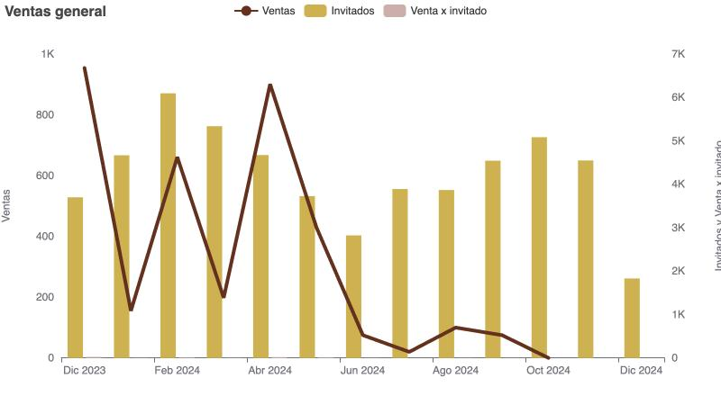</a><br>
<b>Stacked line</b><br>
<sub>Bars and lines on two axes</sub><br>
<sub><a href="https://sntggrz.github.io/Charts-Dashboards-UI-Widgets/charts/line-stack.html">Live</a> · <a href="charts/line-stack.html">Code</a></sub>
</td>
<td valign="top" width="33%">
<a href="https://sntggrz.github.io/Charts-Dashboards-UI-Widgets/charts/area-simple.html">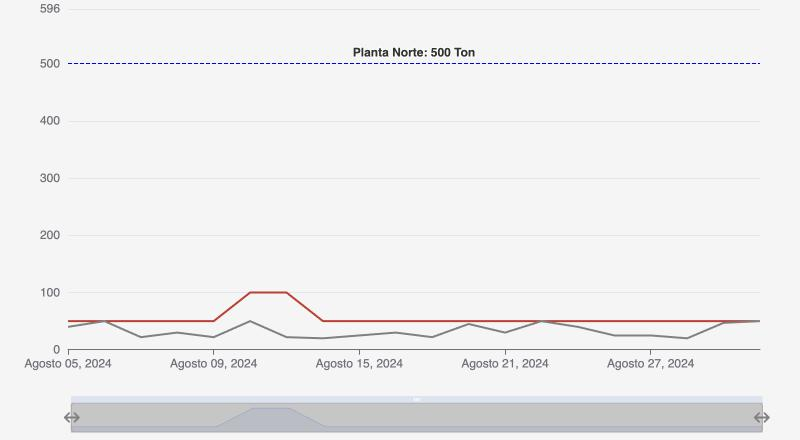</a><br>
<b>Area with goal line</b><br>
<sub>Progress against a target, with zoom</sub><br>
<sub><a href="https://sntggrz.github.io/Charts-Dashboards-UI-Widgets/charts/area-simple.html">Live</a> · <a href="charts/area-simple.html">Code</a></sub>
</td>
<td valign="top" width="33%">
<a href="https://sntggrz.github.io/Charts-Dashboards-UI-Widgets/charts/dynamic-data.html">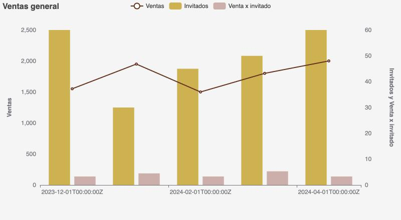</a><br>
<b>Live data</b><br>
<sub>Updates in real time</sub><br>
<sub><a href="https://sntggrz.github.io/Charts-Dashboards-UI-Widgets/charts/dynamic-data.html">Live</a> · <a href="charts/dynamic-data.html">Code</a></sub>
</td>
</tr>
<tr>
<td valign="top" width="33%">
<a href="https://sntggrz.github.io/Charts-Dashboards-UI-Widgets/charts/burndown-sprint.html">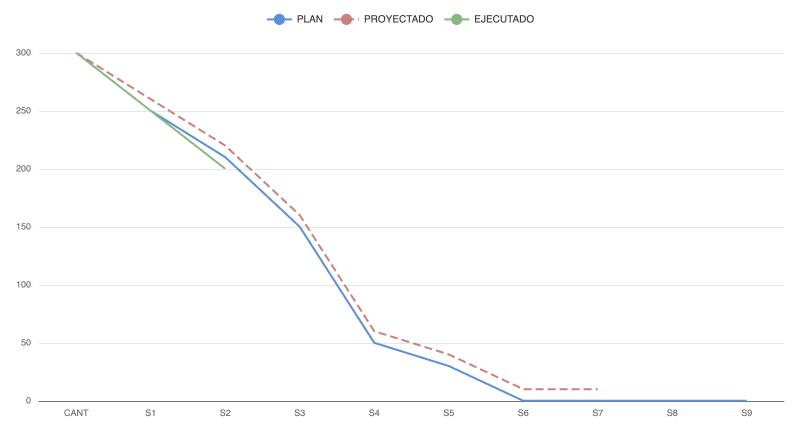</a><br>
<b>Sprint burndown</b><br>
<sub>Plan vs. projected vs. actual</sub><br>
<sub><a href="https://sntggrz.github.io/Charts-Dashboards-UI-Widgets/charts/burndown-sprint.html">Live</a> · <a href="charts/burndown-sprint.html">Code</a></sub>
</td>
<td valign="top" width="33%">
<a href="https://sntggrz.github.io/Charts-Dashboards-UI-Widgets/charts/bar-tick-align.html">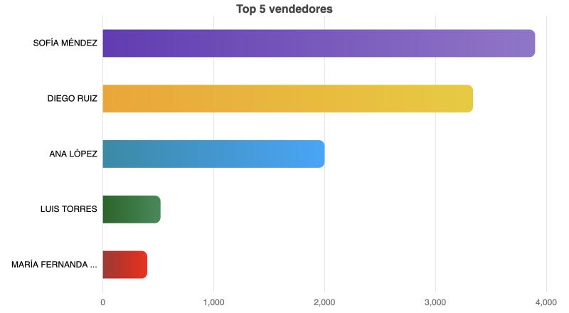</a><br>
<b>Ranking bars</b><br>
<sub>Gradient bars with long labels</sub><br>
<sub><a href="https://sntggrz.github.io/Charts-Dashboards-UI-Widgets/charts/bar-tick-align.html">Live</a> · <a href="charts/bar-tick-align.html">Code</a></sub>
</td>
<td valign="top" width="33%">
<a href="https://sntggrz.github.io/Charts-Dashboards-UI-Widgets/charts/gauge-ring.html">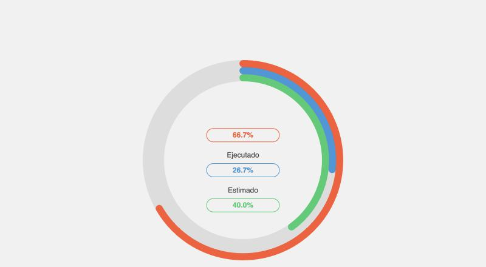</a><br>
<b>Ring gauge</b><br>
<sub>Three KPIs in nested rings</sub><br>
<sub><a href="https://sntggrz.github.io/Charts-Dashboards-UI-Widgets/charts/gauge-ring.html">Live</a> · <a href="charts/gauge-ring.html">Code</a></sub>
</td>
</tr>
<tr>
<td valign="top" width="33%">
<a href="https://sntggrz.github.io/Charts-Dashboards-UI-Widgets/charts/gauge-ring-overlap.html">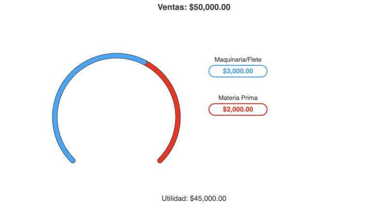</a><br>
<b>Split gauge</b><br>
<sub>Revenue broken into costs</sub><br>
<sub><a href="https://sntggrz.github.io/Charts-Dashboards-UI-Widgets/charts/gauge-ring-overlap.html">Live</a> · <a href="charts/gauge-ring-overlap.html">Code</a></sub>
</td>
<td valign="top" width="33%">
<a href="https://sntggrz.github.io/Charts-Dashboards-UI-Widgets/charts/half-gauge.html">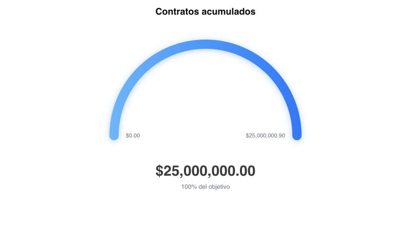</a><br>
<b>Half gauge</b><br>
<sub>Goal progress with animated value</sub><br>
<sub><a href="https://sntggrz.github.io/Charts-Dashboards-UI-Widgets/charts/half-gauge.html">Live</a> · <a href="charts/half-gauge.html">Code</a></sub>
</td>
<td valign="top" width="33%">
<a href="https://sntggrz.github.io/Charts-Dashboards-UI-Widgets/charts/progress-bar.html">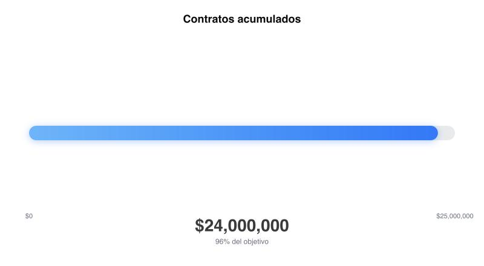</a><br>
<b>Progress bar</b><br>
<sub>Goal tracking with an overflow state</sub><br>
<sub><a href="https://sntggrz.github.io/Charts-Dashboards-UI-Widgets/charts/progress-bar.html">Live</a> · <a href="charts/progress-bar.html">Code</a></sub>
</td>
</tr>
<tr>
<td valign="top" width="33%">
<a href="https://sntggrz.github.io/Charts-Dashboards-UI-Widgets/charts/pie-half-donut.html">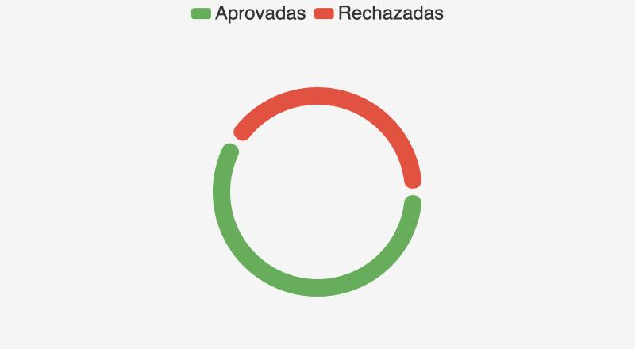</a><br>
<b>Rounded donut</b><br>
<sub>Approved vs. rejected</sub><br>
<sub><a href="https://sntggrz.github.io/Charts-Dashboards-UI-Widgets/charts/pie-half-donut.html">Live</a> · <a href="charts/pie-half-donut.html">Code</a></sub>
</td>
<td valign="top" width="33%">
<a href="https://sntggrz.github.io/Charts-Dashboards-UI-Widgets/charts/text-labels.html">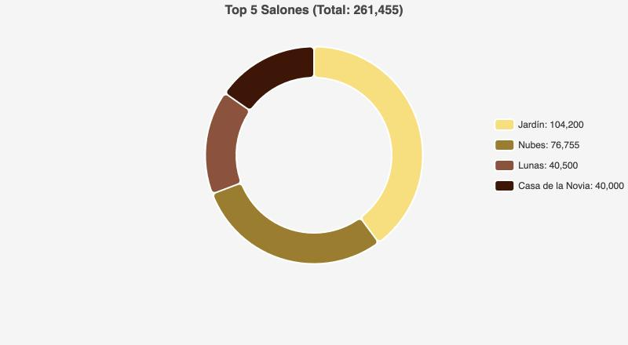</a><br>
<b>Donut with total</b><br>
<sub>Share by category with a legend</sub><br>
<sub><a href="https://sntggrz.github.io/Charts-Dashboards-UI-Widgets/charts/text-labels.html">Live</a> · <a href="charts/text-labels.html">Code</a></sub>
</td>
<td valign="top" width="33%">
<a href="https://sntggrz.github.io/Charts-Dashboards-UI-Widgets/charts/treemap-simple.html">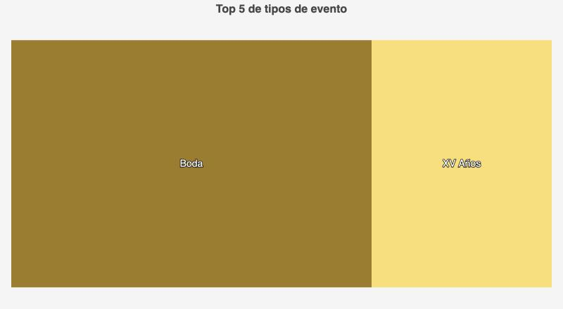</a><br>
<b>Treemap</b><br>
<sub>Proportions at a glance</sub><br>
<sub><a href="https://sntggrz.github.io/Charts-Dashboards-UI-Widgets/charts/treemap-simple.html">Live</a> · <a href="charts/treemap-simple.html">Code</a></sub>
</td>
</tr>
</table>

## Dashboards

Built with [Chart.js](https://www.chartjs.org) 4.

<a href="https://sntggrz.github.io/Charts-Dashboards-UI-Widgets/dashboards/tickets-by-status.html">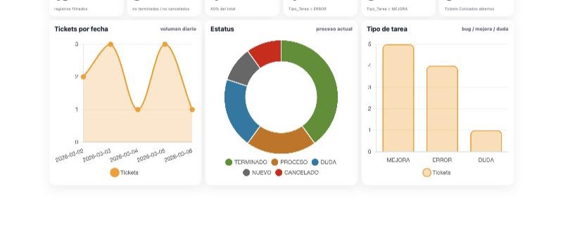</a>

**Support tickets**: KPIs plus volume by date, status and type, with filters · [Live](https://sntggrz.github.io/Charts-Dashboards-UI-Widgets/dashboards/tickets-by-status.html) · [Code](dashboards/tickets-by-status.html)

## Tables

Vanilla JavaScript.

<a href="https://sntggrz.github.io/Charts-Dashboards-UI-Widgets/tables/materials-grouped.html">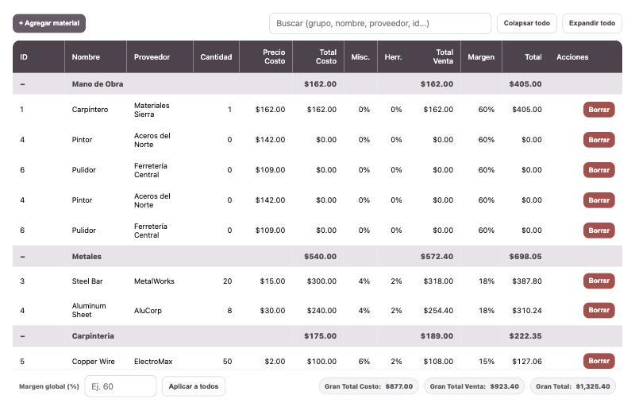</a>

**Materials with margins**: grouped rows with cost, sale and margin totals · [Live](https://sntggrz.github.io/Charts-Dashboards-UI-Widgets/tables/materials-grouped.html) · [Code](tables/materials-grouped.html)

<a href="https://sntggrz.github.io/Charts-Dashboards-UI-Widgets/tables/activities.html">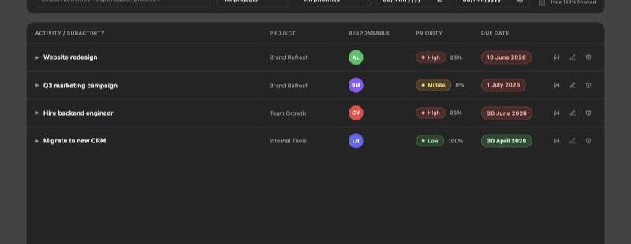</a>

**Activities & subactivities**: nested tasks with owners, priorities and due dates · [Live](https://sntggrz.github.io/Charts-Dashboards-UI-Widgets/tables/activities.html) · [Code](tables/activities.html)

<a href="https://sntggrz.github.io/Charts-Dashboards-UI-Widgets/tables/clients.html">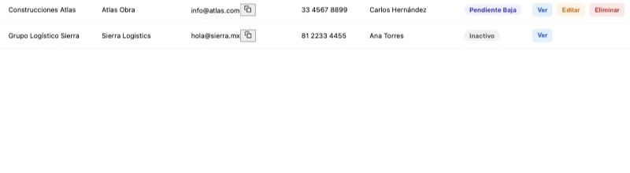</a>

**Clients**: search, sort, copy email and row actions · [Live](https://sntggrz.github.io/Charts-Dashboards-UI-Widgets/tables/clients.html) · [Code](tables/clients.html)

## Calendars & pickers

<table>
<tr>
<td valign="top" width="33%">
<a href="https://sntggrz.github.io/Charts-Dashboards-UI-Widgets/calendars/calendar.html">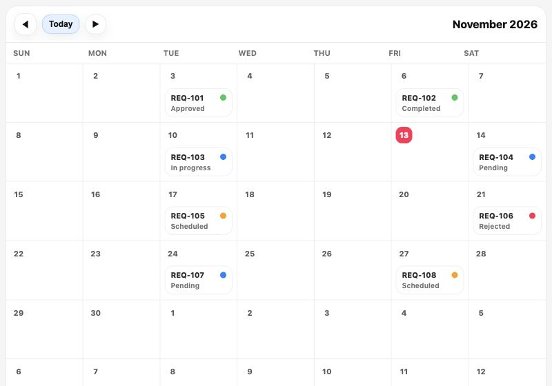</a><br>
<b>Requests calendar</b><br>
<sub>Month view with a status per day</sub><br>
<sub><a href="https://sntggrz.github.io/Charts-Dashboards-UI-Widgets/calendars/calendar.html">Live</a> · <a href="calendars/calendar.html">Code</a></sub>
</td>
<td valign="top" width="33%">
<a href="https://sntggrz.github.io/Charts-Dashboards-UI-Widgets/calendars/time-picker.html"></a><br>
<b>Time picker</b><br>
<sub>Clock-style hour and minute selection</sub><br>
<sub><a href="https://sntggrz.github.io/Charts-Dashboards-UI-Widgets/calendars/time-picker.html">Live</a> · <a href="calendars/time-picker.html">Code</a></sub>
</td>
</tr>
</table>

## Widgets

<table>
<tr>
<td valign="top" width="33%">
<a href="https://sntggrz.github.io/Charts-Dashboards-UI-Widgets/widgets/signature-pad.html">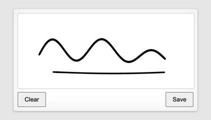</a><br>
<b>Signature pad</b><br>
<sub>Draw and export (mouse or touch)</sub><br>
<sub><a href="https://sntggrz.github.io/Charts-Dashboards-UI-Widgets/widgets/signature-pad.html">Live</a> · <a href="widgets/signature-pad.html">Code</a></sub>
</td>
<td valign="top" width="33%">
<a href="https://sntggrz.github.io/Charts-Dashboards-UI-Widgets/widgets/threshold-slider.html">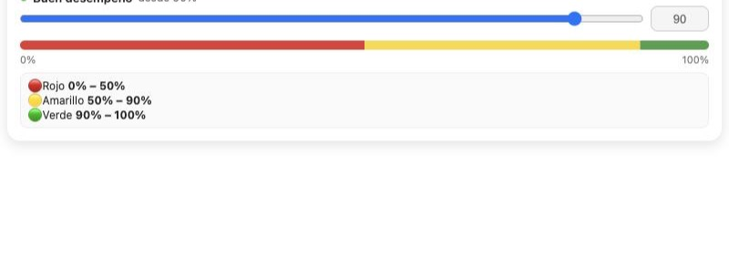</a><br>
<b>Threshold slider</b><br>
<sub>Traffic-light ranges with two handles</sub><br>
<sub><a href="https://sntggrz.github.io/Charts-Dashboards-UI-Widgets/widgets/threshold-slider.html">Live</a> · <a href="widgets/threshold-slider.html">Code</a></sub>
</td>
<td valign="top" width="33%">
<a href="https://sntggrz.github.io/Charts-Dashboards-UI-Widgets/widgets/price-range.html">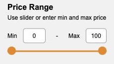</a><br>
<b>Price range</b><br>
<sub>Min / max range input</sub><br>
<sub><a href="https://sntggrz.github.io/Charts-Dashboards-UI-Widgets/widgets/price-range.html">Live</a> · <a href="widgets/price-range.html">Code</a></sub>
</td>
</tr>
</table>

## QR scanning

<a href="https://sntggrz.github.io/Charts-Dashboards-UI-Widgets/qr/image-scanner.html">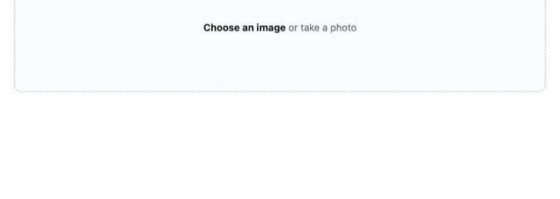</a>

**QR from image**: upload a picture and decode it in the browser · [Live](https://sntggrz.github.io/Charts-Dashboards-UI-Widgets/qr/image-scanner.html) · [Code](qr/image-scanner.html)

Also included: a [camera scanner](https://sntggrz.github.io/Charts-Dashboards-UI-Widgets/qr/camera-scanner.html) ([code](qr/camera-scanner.html)) and a small [Flask decoding service](qr/qr_decoder.py) for decoding QR images on a server.

---

## Embedding the widgets

The widgets don't depend on any backend. When the user does something (saves a signature, picks a time, opens a calendar day, clicks a row action), the widget fires a `widget:action` event. Inside an iframe, it also posts that event to the parent page:

```js
window.addEventListener('message', (e) => {
  if (e.data?.type === 'widget:action') {
    console.log(e.data.action, e.data.payload); // e.g. "save-time", { hour: 9, minute: "30", period: "AM" }
  }
});
```

That makes them easy to plug into any app or platform.

## Running locally

Libraries load from public CDNs, so you need an internet connection.

```bash
git clone https://github.com/sntggrz/Charts-Dashboards-UI-Widgets.git
cd Charts-Dashboards-UI-Widgets
python3 -m http.server 8000
```

Then open `http://localhost:8000`. The QR service in `qr/qr_decoder.py` needs Python with `flask`, `pyzbar` and `Pillow`.
